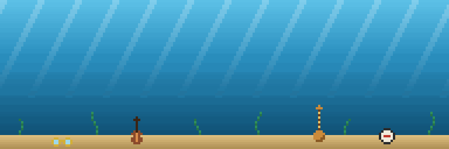
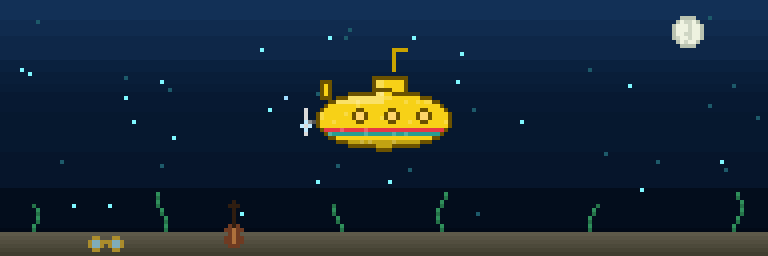

# Yellow Submarine

Yellow Submarine draws a pixel-art submarine from a GitHub account's public
activity, as a looping GIF for a profile README. The GIF is a 3:1 strip that
fills the README's width. A nightly workflow redraws it from the day that just
ended.




## What changes it

| GitHub activity | What it changes |
| --- | --- |
| Total contributions, all years | Size: hull length, portholes, and periscope height |
| Weekly streak: consecutive Monday-Sunday weeks with a contribution | One colored stripe per 4 weeks, up to 5 |
| Contributions on the day that just ended | Busy: crosses twice per loop with bubbles and music notes. Some: crosses once. None: hovers mid-strip with lights on, waiting |
| Hour of your public events in the last 7 days | Water: morning light, afternoon sunset, or night with moon and plankton |
| Contribution milestones 100, 500, 1,000, 2,500 | A keepsake on the seabed: John's glasses, Paul's violin bass, George's sitar, Ringo's bass drum |

The hour comes from the public events API, which keeps about 90 days and sees
no private repositories.

## Usage

1. Copy [examples/profile-workflow.yml](examples/profile-workflow.yml) into your
   profile repository as `.github/workflows/submarine.yml`.
2. Set `utc-offset` to your time zone.
3. Run the workflow once from the Actions tab.
4. Add the GIF to your profile README:

   ```html
   /<you>/submarine/submarine.gif" width="100%" alt="My submarine">
   ```

The workflow force-pushes only the latest GIF to a `submarine` branch, so the
repository does not grow every night. GitHub Actions is free for public
repositories.

### Command line

Node 20 or newer, and the GitHub CLI signed in:

```sh
npm ci
node src/index.mjs <login> --output out/submarine.gif --utc-offset=-5
```

`--stage 1-4`, `--stripes 0-5`, `--activity 0-2`, `--ambient morning|afternoon|night`,
and `--keepsakes 0-4` force a state, to preview it without waiting for the activity.

## Credits

Inspired by [git-koi](https://github.com/yalongwastaken/git-koi), whose weekly
streaks and growth curve this project reuses.

## License

MIT. See [LICENSE](LICENSE).
